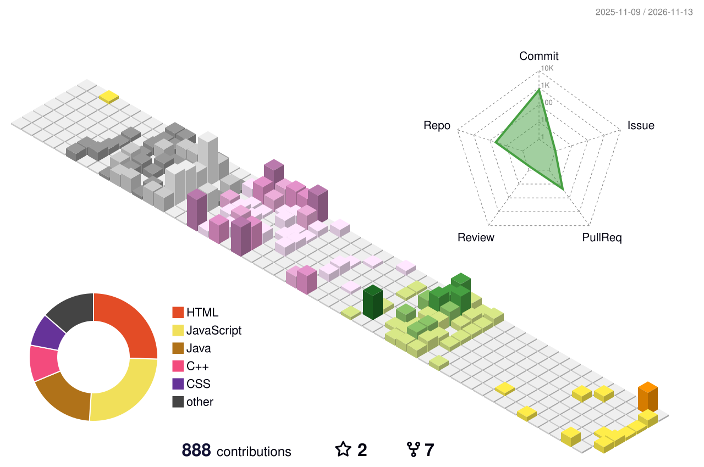

# Hi, I'm Akash 👋

### Computer Science student · Developer · Lifelong learner

---

## About me

- 🎓 B.Tech Computer Science student exploring AI and modern web technologies
- 🛠️ Learning backend development and Python for data science
- 🧠 Practicing data structures and algorithms to strengthen problem-solving skills
- 🌱 Building projects, contributing to open source, and learning in public

## Featured projects

| Project | What it does |
| --- | --- |
| 📋 **Complaint Management System** | Web platform for submitting and managing complaints |
| 📊 **CSV to Dashboard Generator** | AI-powered tool that turns CSV data into interactive dashboards |
| ✅ **To-Do List App** | Task management app with a clean interface |
| 🎮 **Guessor Game App** | Java-based number guessing game |
| 🚀 **CareerVerse AI** | AI-powered career guidance platform for students |

## Tools & technologies

## GitHub at a glance

## 3D contribution history

The 3D calendar is refreshed daily by GitHub Actions. You can also generate it manually from the repository's **Actions** tab.

## Contribution snake

---

*Thanks for stopping by — let's keep learning and building!*

